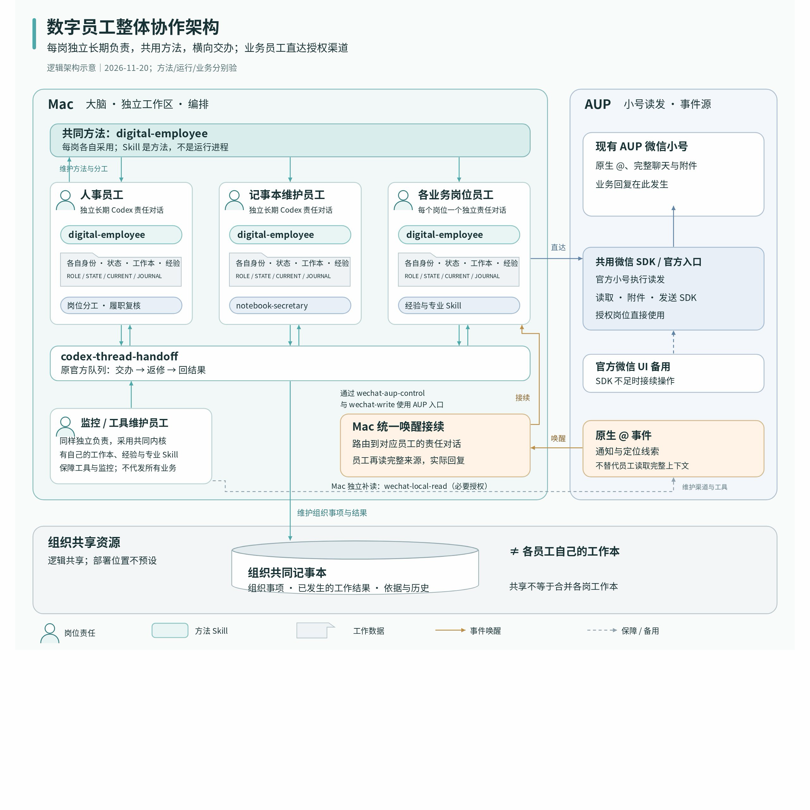
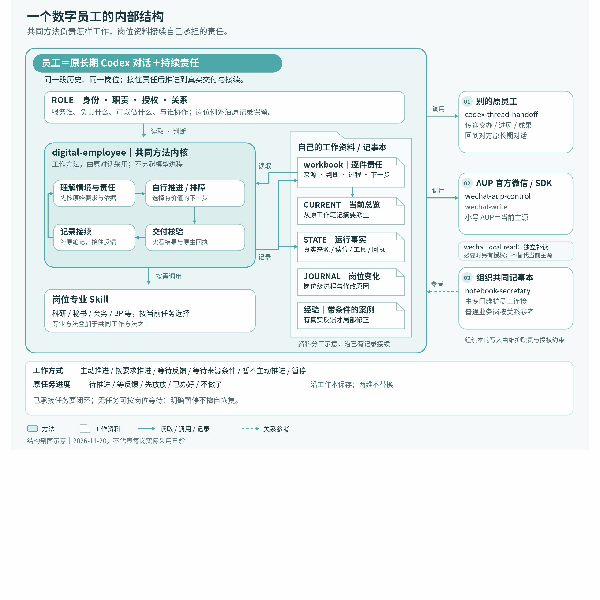
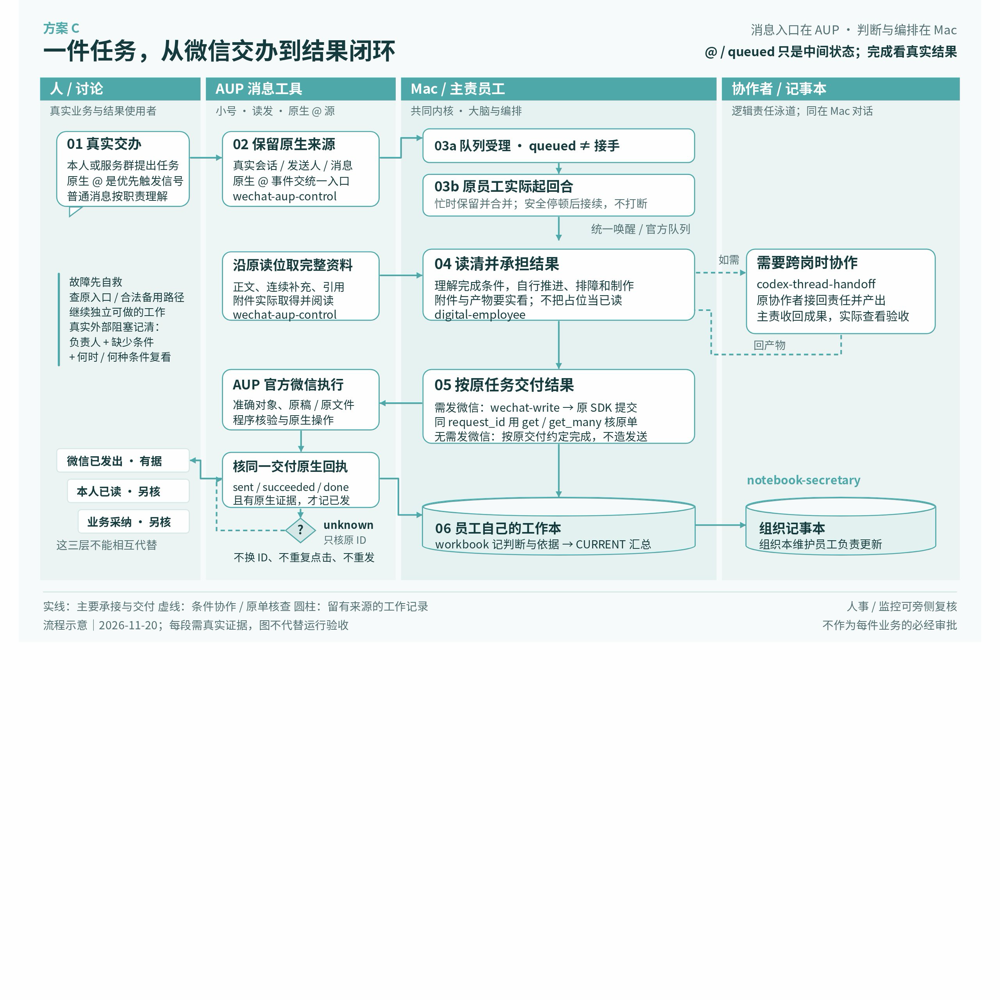

# 他山数字员工 Skills

让已有 AI 对话成为能持续承担责任、相互协作并核实交付的数字员工。六个 Skill 各自独立成目录，包含工作方法、岗位模板、可复用工具及架构图。

**开源协议：MIT。** 本版以2026-11-20工作方法为基础，移除原部署的账号、群映射、本机路径、私人业务案例和数据。它是可移植的方法包，**不包含微信SDK、账号、原生@运行器或完整记事本后端**；复制 Skill 不等于这些服务已接通。

## 六个 Skill

| Skill | 作用 | 谁使用 |
|---|---|---|
| [digital-employee](skills/digital-employee/README.md) | 共同内核：责任、工作状态、工作本、协作、学习与任务闭环 | 每个数字员工，包括人事与维护岗位 |
| [codex-thread-handoff](skills/codex-thread-handoff/README.md) | 向已有责任对话交办和回结果；排队、接手、交付分别核 | 需要跨岗协作的员工 |
| [wechat-aup-control](skills/wechat-aup-control/README.md) | 已授权AUP微信记录、附件与官方界面操作方法 | 有微信职责的员工 |
| [wechat-write](skills/wechat-write/README.md) | 文字、图片、文件的发送闭环与原生回执核验 | 实际交付的员工 |
| [wechat-local-read](skills/wechat-local-read/README.md) | Mac独立补读、来源核对及读取收据 | 确有必要且已获授权的岗位 |
| [notebook-secretary](skills/notebook-secretary/README.md) | 增量维护组织共同记事本，保事实、来源与历史 | 共同记事本维护员工 |

Skill是工作方法，员工是持续责任主体，SDK/运行器是执行组件；这三者不混为一个“机器人”。每岗自己的工作本和组织共同记事本也有不同责任。人事负责共同方法与分工，业务员工可直接使用工具、相互协作；维护员工保障共享工具，不替所有人代发业务。

## 快速开始

前置：Git、Python 3.9+；运行队列库测试另需 Node.js 20+。方法文档本身不要求模型API密钥、微信或服务器。

```bash
git clone https://github.com/TashanGKD/digital-employee-skills.git
cd digital-employee-skills
python3 scripts/check_publication.py
```

先让你的智能体读取 `skills/digital-employee/SKILL.md`，结合原对话、项目约定和真实任务建立岗位。其余 Skill 按需要读取。安装到Codex时，将 `skills/` 下六个同名目录复制到你实际使用的 Skill 搜索目录，保持六者为兄弟目录；常见个人目录为 `~/.codex/skills/`。已有同名技能先比较并备份，**不覆盖现有岗位或运行状态**。宿主没有自动重载时按其正常方式刷新技能目录。

可直接对智能体说：

> 使用 digital-employee，让当前对话继续负责项目资料整理，保留已有历史和任务。先读原工作本，完成已经承接的事项，遇到问题先自行排查；交付后核结果并更新原记录。没有新任务可以等待。

不接微信也能在当前对话和项目目录使用共同方法与工作本。要接外部渠道，再按[运行接入](skills/digital-employee/references/runtime-integration.md)确认实际账号、权限、工具和维护者。这里不会安装服务或创建定时任务。

## 三张架构图

### A：整体协作架构



### B：每个员工的内部结构



### C：一件任务从消息到交付



[关系说明与SVG源文件](docs/ARCHITECTURE.md)。参考部署是AUP上的已授权微信账号负责读、发及原生@来源，Mac负责Codex大脑、工作区与编排。图表示方法与责任关系，不是所有运行能力已验收的证明。

## 常用命令

以下检查只读仓库或使用隔离测试，不读取真实微信、启动员工、修改调度或发送业务。

| 命令 | 用途 |
|---|---|
| `python3 scripts/check_publication.py` | 文件清单、自覆盖哈希、脱敏模式、六个Skill及本地链接检查 |
| `sh scripts/check_publication.self-test.sh` | 私有标识、越界链接、软链、重复名、自身改动等负例 |
| `python3 skills/digital-employee/scripts/check_method.py --check` | 方法文件、状态与版本一致性 |
| `sh skills/digital-employee/scripts/check_method.self-test.sh` | 方法发布的负例及打包隔离回归 |
| `python3 skills/digital-employee/scripts/workbook.py --help` | 查看工作本汇总用法；实际写入须指定岗位目录与执行参数 |
| `python3 -B -m unittest discover -s skills/notebook-secretary/scripts -p 'test_*.py' -v` | 隔离回环客户端测试，不验证生产主库 |
| `node --test skills/codex-thread-handoff/scripts/queue_closeout.test.mjs` | mock队列整理测试，不连接真实宿主 |

## 目录

```text
skills/
  digital-employee/       # SKILL、README、方法参考、模板、工作本与校验脚本
  codex-thread-handoff/   # SKILL、README、队列语义与可注入调用器的整理库
  wechat-aup-control/     # SKILL、README
  wechat-write/           # SKILL、README
  wechat-local-read/      # SKILL、README
  notebook-secretary/    # SKILL、README、来源/判断参考与隔离客户端
scripts/                 # 公开发布检查及同名自测入口
.githooks/               # 可启用的本地提交检查
.github/workflows/       # 自动执行同一套包与隔离测试
docs/                    # 架构、部署边界与版本来源
MANIFEST.json            # 全量公开载荷校验，包含检查器自身
LICENSE
```

## 文档索引

- [架构与责任关系](docs/ARCHITECTURE.md)
- [运行接入与外部依赖](skills/digital-employee/references/runtime-integration.md)
- [发布范围、改写说明与验证边界](docs/RELEASE.md)
- [原方法输入文件哈希](docs/UPSTREAM.json)
- [贡献与校验方法](CONTRIBUTING.md)

## 环境变量与部署

阅读方法、检查仓库和运行隔离测试均**无必填环境变量**。不要求你导出账号、token或SSH密码。

真实工具由部署方提供；参数与凭据通过其现有受支持配置传入，不写进Skill或这个仓库。本包不提供自动化部署、不创建账号/群/服务、不修改已有调度。队列库需要调用方注入经过核实的宿主调用器；记事本脚本只支持数字回环的隔离合同，不充当正式云端SDK。

## 核心工作约定

已经承接的事情要推进到实际结果、必要交付/回执和工作本更新；确实受阻就保责任人、原因、下一步与复看条件。候选不自动成为承诺，没有任务不凭空制造工作。

`queued`、`accepted`、`sourceReady`和草稿不是业务完成。发送结果未知核原请求，不换ID重复发；微信发出、对方已读和业务采纳分别核。工作本不是监控报表，监控读取既有记录，不让每个员工另填一套。
